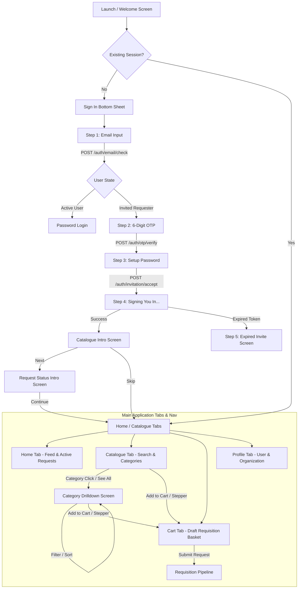

# Functional Specification Document (FSD): Backend APIs

## ZeroQue Procurement Mobile Application (ZQApp)

- **Document Version**: 1.0.0
- **Status**: Ready for Backend Implementation
- **Target Audience**: Backend Engineering Team, Mobile Engineering Team, Product Managers, QA
- **System Architecture**: Multi-Tenant B2B Requisition & Procurement Engine (`accounts.zeroque.com`)
- **Default Currency**: GBP (`£`)

---

## 1. Project Overview and Scope

### 1.1 Executive Summary

**ZeroQue (ZQApp)** is a corporate B2B e-procurement and requisition mobile application built with React Native and Expo Router (SDK 57). The platform empowers organizational employees (**Requesters**) to browse approved vendor catalogues, construct departmental purchase baskets, submit requisitions, and track multi-stage approval lifecycles in real time without spreadsheets or email chains.

### 1.2 System Scope

The mobile application interfaces with a multi-tenant backend architecture. User authentication, invitation acceptance, and organizational membership are managed via the corporate identity domain `accounts.zeroque.com`.
The backend must provide RESTful JSON APIs covering six core operational domains:

1. **Identity, Authentication & Organization Onboarding**: Domain-based account lookup, 6-digit email OTP verification, invite verification, password creation, and JWT session lifecycle.
2. **User Profile & Multi-Tenancy**: Organization context (`Northwind Distribution`), roles (`Requester`), spending permissions, and user preferences.
3. **Product Taxonomy & Catalogue**: Hierarchical categories, curated feeds ("Order Again", "Category Carousels"), search with debounced text queries, and sorting/filtering.
4. **Procurement Cart & Line-Item Stepper**: Server-synchronized draft carts, quantity steppers, currency formatting, and floating tab bar badge counters.
5. **Requisition Lifecycle & Approval Pipeline**: Submission of purchase orders, 3-stage progress tracking (`submitted`, `awaiting_approval`, `approved`, `delivered`), timeline history, and pending approver visibility ("who it's waiting on").
6. **Onboarding & Walkthrough State**: Requester onboarding status persistence.

---

## 2. Application Modules and User Flows



### 2.1 User Flows Breakdown

#### Flow 1: Corporate Invitation & Authentication

1. **Welcome Screen (`src/app/index.tsx`)**: User taps "Sign in". A glassmorphic bottom sheet (`SignInBottomSheet.tsx`) expands.
2. **Step 1 - Email (`step = "email"`)**: User inputs corporate email (e.g., `sarah.jones@worshipstreet.com`). Validates standard email regex. On continue, requests email status and triggers OTP dispatch.
3. **Step 2 - Email OTP Verification (`step = "otp"`)**: 6-digit numeric input code. Validates against OTP backend. Can navigate back to change email.
4. **Step 3 - Account Activation (`step = "setPassword"`)**: Displays disabled fields for Verified Email and Full Name ("Sarah Jones"), alongside Organization context ("Northwind Distribution", role "Requester"). Inputs: `createPassword` and `confirmPassword`.
5. **Step 4 - Signing In (`step = "signingIn"`)**: Progress spinner / avatar display. Executes login and generates JWT tokens.
6. **Step 5 - Expired Invite (`step = "expiredInvite"`)**: Shown if invite token has expired or is invalid. Prompts user to contact administrator or retry.

#### Flow 2: Onboarding Walkthrough

1. **Catalogue Intro (`src/app/cataloguescreen.tsx`)**: Introduces the single-catalogue procurement value proposition. Actions: "Skip" (navigates to `/(tabs)/home`) or "Next" (navigates to `/requestscreen`).
2. **Request Status Intro (`src/app/requestscreen.tsx`)**: Demonstrates request tracking ("Awaiting approval" pill, progress bar, approval history). Action: "Continue" (navigates to `/(tabs)/home`).

#### Flow 3: Catalogue Browsing & Search

1. **Overview Screen (`src/app/(tabs)/catalogue.tsx`)**:
   - Universal search input (`SearchTextInput.tsx`) queries all approved products across title, category, and supplier.
   - "Order again" horizontal carousel with `ProductCard` items and stepper.
   - Category pill grid: "Stationery", "Packaging", "Safety", "Cleaning", "IT".
   - Vertical category sections with horizontal scrolling carousels.
2. **Category Drill-Down (`src/app/(tabs)/category.tsx`)**:
   - Navigated via Category pill or section "See all".
   - Category-scoped search input.
   - "Sort" and "Filter" trigger buttons.
   - Vertical list of `ProductRowCard` items with package details, supplier name, unit price, and Add to Cart stepper.

#### Flow 4: Cart & Stepper Synchronization

1. Tapping "+" or "Add to cart" transitions the button into an interactive stepper (- [qty] +).
2. Changing quantity triggers cart sync and updates the floating bottom tab bar badge (`DEFAULT_CART_COUNT`).
3. Decrementing to 0 removes the item from the cart.

#### Flow 5: Requisition Tracking & Approval Flow

1. Submission converts cart items into a formal Requisition.
2. Requisition transitions through statuses: `submitted` -> `awaiting_approval` -> `approved` -> `delivered`.
3. Displays the current approver ("who it's waiting on") and stage timeline.

---

## 3. Existing vs Required API Inventory

| Current State in Codebase     | Finding                                                                                                              | Architectural Remedy                                                              |
| :---------------------------- | :------------------------------------------------------------------------------------------------------------------- | :-------------------------------------------------------------------------------- |
| **Network Client / Services** | No Axios, Fetch, or RTK Query instances exist. Slices folder is empty.                                               | Establish centralized API client with token interceptor and multi-tenant headers. |
| **Authentication & Invites**  | Hardcoded mock check `createPassword === "zeroque"`, static name "Sarah Jones", static org "Northwind Distribution". | Implement Auth & Tenant Onboarding API Suite (`/api/v1/auth/*`).                  |
| **Catalogue & Products**      | 1,261 lines of hardcoded mock arrays in `src/constants/catalogue.ts`.                                                | Implement Catalogue & Search REST endpoints with pagination.                      |
| **Cart & Badges**             | `cartCount` hardcoded to `DEFAULT_CART_COUNT = 1` in `src/constants/tabBar.ts`. Steppers only log to `console.log`.  | Implement Cart State CRUD endpoints (`/api/v1/cart/*`).                           |
| **Requisitions & Tracking**   | Visual mockup hardcoded in `requestscreen.tsx`.                                                                      | Implement Requisitions & Approvals API Suite (`/api/v1/requisitions/*`).          |

---

## 4. Complete List of Required APIs

### Domain A: Authentication & Identity (`accounts.zeroque.com`)

1. `POST /api/v1/auth/email/check` — Check user email status, tenant identity, and invite state.
2. `POST /api/v1/auth/otp/send` — Request a 6-digit email OTP.
3. `POST /api/v1/auth/otp/verify` — Verify the 6-digit OTP code.
4. `POST /api/v1/auth/invitation/accept` — Complete account setup with password and join organization.
5. `POST /api/v1/auth/login` — Authenticate active user with email and password.
6. `POST /api/v1/auth/token/refresh` — Refresh expired JWT access token.
7. `POST /api/v1/auth/logout` — Invalidate user session and tokens.

### Domain B: User Profile & Multi-Tenancy

8. `GET /api/v1/users/me` — Fetch authenticated user profile, organization, and permissions.
9. `PATCH /api/v1/users/me/onboarding` — Update user onboarding walkthrough completion status.
10. `GET /api/v1/tenants/current` — Fetch active tenant procurement policies, currency (`£`), and details.

### Domain C: Catalogue, Categories & Products

11. `GET /api/v1/categories` — Fetch all procurement product categories.
12. `GET /api/v1/catalogue/feed` — Fetch home catalogue feed (Order Again, Categories, Featured Sections).
13. `GET /api/v1/products` — Filtered, searchable, and paginated product listing.
14. `GET /api/v1/products/order-again` — Retrieve past ordered products for rapid re-ordering.
15. `GET /api/v1/products/:id` — Retrieve full product specification and stock status.

### Domain D: Cart Management

16. `GET /api/v1/cart` — Fetch active draft requisition cart and total item count.
17. `POST /api/v1/cart/items` — Add product to cart or increment quantity via stepper.
18. `PUT /api/v1/cart/items/:productId` — Update item quantity directly.
19. `DELETE /api/v1/cart/items/:productId` — Remove specific item from cart.
20. `DELETE /api/v1/cart` — Clear all items from draft cart.

### Domain E: Purchase Requisitions & Approvals

21. `POST /api/v1/requisitions` — Submit active cart as a formal purchase requisition.
22. `GET /api/v1/requisitions` — List user's requisitions with status filter.
23. `GET /api/v1/requisitions/:id` — Get requisition details, progress bar stages, and approver history.
24. `POST /api/v1/requisitions/:id/cancel` — Cancel pending requisition prior to approval.

---

## 5. Detailed API Specifications & Payloads

```
Standard Headers Required for All Authenticated Endpoints:
Authorization: Bearer <JWT_ACCESS_TOKEN>
X-Tenant-Domain: accounts.zeroque.com
X-Organization-Id: <TENANT_UUID>
Content-Type: application/json
Accept: application/json
```

---

### 5.1 Domain A: Authentication & Identity

#### API 01: Check Email & Invitation Status

- **Endpoint**: `POST /api/v1/auth/email/check`
- **Purpose**: Validates email format, checks whether email belongs to a registered company tenant, and detects if the user is an active member or an invited requester.
- **Trigger**: `SignInBottomSheet.tsx` -> `handleEmailContinue()`.
- **Auth**: None (Public).

**Request Payload**:

```json
{
  "email": "sarah.jones@worshipstreet.com"
}
```

**Expected Response (200 OK - Invited Requester)**:

```json
{
  "success": true,
  "data": {
    "email": "sarah.jones@worshipstreet.com",
    "accountStatus": "PENDING_INVITATION",
    "isRegistered": false,
    "hasPendingInvite": true,
    "user": {
      "fullName": "Sarah Jones",
      "role": "Requester"
    },
    "organization": {
      "id": "org_northwind_01",
      "name": "Northwind Distribution",
      "domain": "accounts.zeroque.com"
    },
    "otpRequired": true
  }
}
```

**Alternative Response (200 OK - Existing Active User)**:

```json
{
  "success": true,
  "data": {
    "email": "sarah.jones@worshipstreet.com",
    "accountStatus": "ACTIVE",
    "isRegistered": true,
    "hasPendingInvite": false,
    "user": {
      "fullName": "Sarah Jones",
      "role": "Requester"
    },
    "organization": {
      "id": "org_northwind_01",
      "name": "Northwind Distribution"
    },
    "otpRequired": false
  }
}
```

**Error Responses**:

- `400 Bad Request`: `{"success": false, "error": {"code": "INVALID_EMAIL", "message": "Please enter a valid email address"}}`
- `404 Not Found`: `{"success": false, "error": {"code": "DOMAIN_NOT_RECOGNIZED", "message": "This email domain does not have access to ZeroQue"}}`

---

#### API 02: Send Email OTP Code

- **Endpoint**: `POST /api/v1/auth/otp/send`
- **Purpose**: Dispatches a 6-digit numeric verification code to the requester's corporate inbox.
- **Trigger**: Automatic trigger upon email check returning `otpRequired: true`, or user tapping "Resend code".
- **Auth**: None (Public).

**Request Payload**:

```json
{
  "email": "sarah.jones@worshipstreet.com",
  "reason": "INVITATION_VERIFICATION"
}
```

**Expected Response (200 OK)**:

```json
{
  "success": true,
  "data": {
    "message": "A 6-digit code has been sent to sarah.jones@worshipstreet.com",
    "expiresInSeconds": 300,
    "resendAvailableInSeconds": 30
  }
}
```

---

#### API 03: Verify Email OTP Code

- **Endpoint**: `POST /api/v1/auth/otp/verify`
- **Purpose**: Validates the 6-digit OTP code against the email address.
- **Trigger**: `SignInBottomSheet.tsx` -> `handleVerifyOtp()` after user completes 6-pin input.
- **Auth**: None (Public).

**Request Payload**:

```json
{
  "email": "sarah.jones@worshipstreet.com",
  "otp": "482910"
}
```

**Expected Response (200 OK)**:

```json
{
  "success": true,
  "data": {
    "verificationToken": "vtoken_99b0c2a812df49e1a",
    "expiresAt": "2026-10-23T12:30:00Z",
    "user": {
      "fullName": "Sarah Jones",
      "email": "sarah.jones@worshipstreet.com",
      "role": "Requester"
    },
    "organization": {
      "id": "org_northwind_01",
      "name": "Northwind Distribution"
    }
  }
}
```

**Error Responses**:

- `400 Bad Request`: `{"success": false, "error": {"code": "INVALID_OTP", "message": "Invalid 6-digit verification code"}}`
- `410 Gone`: `{"success": false, "error": {"code": "OTP_EXPIRED", "message": "Verification code has expired. Request a new one"}}`

---

#### API 04: Accept Invitation & Create Password

- **Endpoint**: `POST /api/v1/auth/invitation/accept`
- **Purpose**: Completes employee onboarding by verifying password complexity, accepting the invitation token, and joining the organization as a Requester.
- **Trigger**: `SignInBottomSheet.tsx` -> `handlePasswordContinue()`.
- **Auth**: Verification Token Bearer or payload field.

**Request Payload**:

```json
{
  "verificationToken": "vtoken_99b0c2a812df49e1a",
  "email": "sarah.jones@worshipstreet.com",
  "password": "Password123!",
  "confirmPassword": "Password123!",
  "agreedToTerms": true
}
```

**Expected Response (200 OK)**:

```json
{
  "success": true,
  "data": {
    "user": {
      "id": "usr_sarah_001",
      "email": "sarah.jones@worshipstreet.com",
      "fullName": "Sarah Jones",
      "role": "Requester",
      "organizationId": "org_northwind_01",
      "organizationName": "Northwind Distribution"
    },
    "tokens": {
      "accessToken": "eyJhbGciOiJIUzI1NiIs...",
      "refreshToken": "d820f837eac4819a...",
      "expiresIn": 86400,
      "tokenType": "Bearer"
    }
  }
}
```

**Error Responses**:

- `400 Bad Request`: `{"success": false, "error": {"code": "PASSWORDS_DO_NOT_MATCH", "message": "Confirm password does not match create password"}}`
- `410 Gone`: `{"success": false, "error": {"code": "INVITATION_EXPIRED", "message": "This invite has expired. Ask admin for a new one."}}` -> _Triggers `step = "expiredInvite"` in UI_.

---

#### API 05: User Login (Password Authentication)

- **Endpoint**: `POST /api/v1/auth/login`
- **Purpose**: Authenticates active users who already completed their invitation and account setup.
- **Trigger**: Active user sign-in from Step 1 / password modal.
- **Auth**: None (Public).

**Request Payload**:

```json
{
  "email": "sarah.jones@worshipstreet.com",
  "password": "Password123!"
}
```

**Expected Response (200 OK)**:

```json
{
  "success": true,
  "data": {
    "user": {
      "id": "usr_sarah_001",
      "email": "sarah.jones@worshipstreet.com",
      "fullName": "Sarah Jones",
      "role": "Requester",
      "organizationId": "org_northwind_01",
      "organizationName": "Northwind Distribution",
      "onboardingCompleted": false
    },
    "tokens": {
      "accessToken": "eyJhbGciOi...",
      "refreshToken": "d820f837...",
      "expiresIn": 86400,
      "tokenType": "Bearer"
    }
  }
}
```

---

#### API 06: Refresh Access Token

- **Endpoint**: `POST /api/v1/auth/token/refresh`
- **Purpose**: Exchanges a valid refresh token for a fresh access token without interrupting requester workflow.
- **Trigger**: Automatic Axios/HTTP interceptor on HTTP 401 response.
- **Auth**: None (Refresh Token in payload).

**Request Payload**:

```json
{
  "refreshToken": "d820f837eac4819a..."
}
```

**Expected Response (200 OK)**:

```json
{
  "success": true,
  "data": {
    "accessToken": "eyJhbGciOiJIUzI1Ni...",
    "expiresIn": 86400,
    "tokenType": "Bearer"
  }
}
```

---

#### API 07: User Logout

- **Endpoint**: `POST /api/v1/auth/logout`
- **Purpose**: Revokes the refresh token and clears push notification tokens.
- **Trigger**: User signs out from `profile.tsx`.
- **Auth**: Bearer Token required.

**Request Payload**:

```json
{
  "refreshToken": "d820f837eac4819a..."
}
```

**Expected Response (200 OK)**:

```json
{
  "success": true,
  "message": "Logged out successfully"
}
```

---

### 5.2 Domain B: User Profile & Multi-Tenancy

#### API 08: Get Current User Profile

- **Endpoint**: `GET /api/v1/users/me`
- **Purpose**: Provides requester info, permissions, spending limits, department, and default currency.
- **Trigger**: App initial load after login, and visiting `profile.tsx`.
- **Auth**: Bearer Token required.

**Expected Response (200 OK)**:

```json
{
  "success": true,
  "data": {
    "id": "usr_sarah_001",
    "email": "sarah.jones@worshipstreet.com",
    "fullName": "Sarah Jones",
    "avatarUrl": null,
    "role": "Requester",
    "department": "Operations",
    "spendingLimit": 500.0,
    "currency": "£",
    "onboardingCompleted": true,
    "organization": {
      "id": "org_northwind_01",
      "name": "Northwind Distribution",
      "subdomain": "northwind",
      "catalogueAccess": ["stationery", "packaging", "safety", "cleaning", "it"]
    }
  }
}
```

---

#### API 09: Update Onboarding Status

- **Endpoint**: `PATCH /api/v1/users/me/onboarding`
- **Purpose**: Marks the onboarding walkthrough as completed so subsequent logins bypass `cataloguescreen.tsx` and `requestscreen.tsx`.
- **Trigger**: Tapping "Skip" in `cataloguescreen.tsx` or "Continue" in `requestscreen.tsx`.
- **Auth**: Bearer Token required.

**Request Payload**:

```json
{
  "onboardingCompleted": true
}
```

**Expected Response (200 OK)**:

```json
{
  "success": true,
  "data": {
    "onboardingCompleted": true
  }
}
```

---

### 5.3 Domain C: Catalogue, Categories & Products

#### API 10: Get Catalogue Categories

- **Endpoint**: `GET /api/v1/categories`
- **Purpose**: Returns the list of approved product categories displayed in the category pill bar on the Catalogue screen.
- **Trigger**: `CatalogueScreen` mount.
- **Auth**: Bearer Token required.

**Expected Response (200 OK)**:

```json
{
  "success": true,
  "data": [
    {
      "id": "stationery",
      "name": "Stationery",
      "displayOrder": 1,
      "imageUrl": "https://cdn.zeroque.com/categories/stationery.png",
      "productCount": 42
    },
    {
      "id": "packaging",
      "name": "Packaging",
      "displayOrder": 2,
      "imageUrl": "https://cdn.zeroque.com/categories/packaging.png",
      "productCount": 28
    },
    {
      "id": "safety",
      "name": "Safety",
      "displayOrder": 3,
      "imageUrl": "https://cdn.zeroque.com/categories/safety.png",
      "productCount": 19
    },
    {
      "id": "cleaning",
      "name": "Cleaning",
      "displayOrder": 4,
      "imageUrl": "https://cdn.zeroque.com/categories/cleaning.png",
      "productCount": 24
    },
    {
      "id": "it",
      "name": "IT",
      "displayOrder": 5,
      "imageUrl": "https://cdn.zeroque.com/categories/it.png",
      "productCount": 35
    }
  ]
}
```

---

#### API 11: Get Catalogue Feed (Dashboard Aggregation)

- **Endpoint**: `GET /api/v1/catalogue/feed`
- **Purpose**: Provides a consolidated payload containing the "Order Again" product carousel and category-specific carousels for high performance without multiple roundtrips.
- **Trigger**: `CatalogueScreen` (`src/app/(tabs)/catalogue.tsx`).
- **Auth**: Bearer Token required.

**Expected Response (200 OK)**:

```json
{
  "success": true,
  "data": {
    "orderAgain": [
      {
        "id": "ord-1",
        "name": "A4 copier paper, 80gsm",
        "category": "Stationery",
        "packageInfo": "Pack of 5 reams",
        "supplier": "Canal Office Supplies",
        "price": 10.5,
        "currency": "£",
        "imageUrl": "https://cdn.zeroque.com/products/a4-paper.jpg",
        "inStock": true,
        "initialQuantity": 0
      },
      {
        "id": "ord-4",
        "name": "Ballpoint Pens Black Medium",
        "category": "Stationery",
        "packageInfo": "Box of 50",
        "supplier": "Canal Office Supplies",
        "price": 6.99,
        "currency": "£",
        "imageUrl": "https://cdn.zeroque.com/products/pens.jpg",
        "inStock": true,
        "initialQuantity": 0
      }
    ],
    "sections": [
      {
        "id": "stationery",
        "title": "Stationery",
        "products": [
          {
            "id": "stat-1",
            "name": "A4 Copier Paper 80gsm",
            "category": "Stationery",
            "packageInfo": "Box of 5 reams (2,500 sheets)",
            "supplier": "Canal Office Supplies",
            "price": 22.5,
            "currency": "£",
            "imageUrl": "https://cdn.zeroque.com/products/a4-paper-box.jpg",
            "inStock": true,
            "initialQuantity": 0
          }
        ]
      },
      {
        "id": "packaging",
        "title": "Packaging",
        "products": [
          {
            "id": "pack-1",
            "name": "Heavy Duty Double Wall Boxes",
            "category": "Packaging",
            "packageInfo": "Pack of 15 (457x305x305mm)",
            "supplier": "PackTech Solutions",
            "price": 28.5,
            "currency": "£",
            "imageUrl": "https://cdn.zeroque.com/products/boxes.jpg",
            "inStock": true,
            "initialQuantity": 0
          }
        ]
      }
    ]
  }
}
```

---

#### API 12: Search & Filter Products

- **Endpoint**: `GET /api/v1/products`
- **Purpose**: Paginated, filtered search used by both the universal search in `catalogue.tsx` and the category drill-down in `category.tsx`.
- **Query Parameters**:
  - `q` (string, optional): Search keyword (searches name, supplier, packageInfo).
  - `category` (string, optional): Category ID (e.g., `stationery`).
  - `supplier` (string, optional): Filter by supplier name.
  - `sort` (string, optional): `price_asc` | `price_desc` | `name_asc` | `relevance`.
  - `page` (integer, default: 1).
  - `limit` (integer, default: 20).
- **Trigger**: Search query typing (debounced) or Sort/Filter action sheet in `category.tsx`.
- **Auth**: Bearer Token required.

**Example Request**:
`GET /api/v1/products?q=paper&category=stationery&sort=price_asc&page=1&limit=20`

**Expected Response (200 OK)**:

```json
{
  "success": true,
  "data": {
    "items": [
      {
        "id": "stat-1",
        "name": "A4 Copier Paper 80gsm",
        "category": "Stationery",
        "packageInfo": "Box of 5 reams (2,500 sheets)",
        "supplier": "Canal Office Supplies",
        "price": 22.5,
        "currency": "£",
        "imageUrl": "https://cdn.zeroque.com/products/a4-paper-box.jpg",
        "inStock": true,
        "initialQuantity": 0
      }
    ],
    "pagination": {
      "currentPage": 1,
      "totalPages": 3,
      "totalItems": 48,
      "limit": 20,
      "hasNextPage": true
    }
  }
}
```

---

#### API 13: Get Product Detail

- **Endpoint**: `GET /api/v1/products/:id`
- **Purpose**: Returns complete product metadata, specifications, and live warehouse inventory.
- **Trigger**: Tapping a product card (`handleProductPress`).
- **Auth**: Bearer Token required.

**Expected Response (200 OK)**:

```json
{
  "success": true,
  "data": {
    "id": "stat-1",
    "name": "A4 Copier Paper 80gsm",
    "category": "Stationery",
    "categoryId": "stationery",
    "packageInfo": "Box of 5 reams (2,500 sheets)",
    "supplier": "Canal Office Supplies",
    "supplierId": "sup_canal_01",
    "price": 22.5,
    "currency": "£",
    "imageUrl": "https://cdn.zeroque.com/products/a4-paper-box.jpg",
    "inStock": true,
    "stockLevel": 120,
    "description": "Premium multi-purpose office paper suitable for laser, inkjet, and high-volume copiers.",
    "sku": "COP-A4-80",
    "requiresApproval": false
  }
}
```

---

### 5.4 Domain D: Cart & Stepper Synchronization

#### API 14: Get Active Cart

- **Endpoint**: `GET /api/v1/cart`
- **Purpose**: Retrieves the requester's draft procurement basket, line items, item counts, subtotal, and badge counter.
- **Trigger**: App launch (for tab badge), opening `cart.tsx`, and stepper sync.
- **Auth**: Bearer Token required.

**Expected Response (200 OK)**:

```json
{
  "success": true,
  "data": {
    "cartId": "crt_98a72b1",
    "organizationId": "org_northwind_01",
    "totalItemsCount": 1,
    "uniqueProductsCount": 1,
    "currency": "£",
    "subtotal": 10.5,
    "items": [
      {
        "productId": "ord-1",
        "name": "A4 copier paper, 80gsm",
        "packageInfo": "Pack of 5 reams",
        "supplier": "Canal Office Supplies",
        "unitPrice": 10.5,
        "quantity": 1,
        "lineTotal": 10.5,
        "imageUrl": "https://cdn.zeroque.com/products/a4-paper.jpg"
      }
    ]
  }
}
```

---

#### API 15: Add or Update Cart Item (Stepper Action)

- **Endpoint**: `POST /api/v1/cart/items`
- **Purpose**: Called whenever a user interacts with the `AppButton` in stepper mode (`variant="stepper"`). Adding item or incrementing/decrementing quantity.
- **Trigger**: `onAddToCart(product, quantity)` in `ProductCard` and `ProductRowCard`.
- **Auth**: Bearer Token required.

**Request Payload**:

```json
{
  "productId": "ord-1",
  "quantity": 2
}
```

**Expected Response (200 OK)**:

```json
{
  "success": true,
  "data": {
    "cartId": "crt_98a72b1",
    "totalItemsCount": 2,
    "subtotal": 21.0,
    "updatedItem": {
      "productId": "ord-1",
      "quantity": 2,
      "unitPrice": 10.5,
      "lineTotal": 21.0
    }
  }
}
```

**Business Rule**: If `quantity` is 0, backend automatically removes the line item from the cart.

---

#### API 16: Remove Item from Cart

- **Endpoint**: `DELETE /api/v1/cart/items/:productId`
- **Purpose**: Removes a line item completely from the cart.
- **Trigger**: Stepper dropped to 0 or swipe-to-delete in Cart screen.
- **Auth**: Bearer Token required.

**Expected Response (200 OK)**:

```json
{
  "success": true,
  "data": {
    "cartId": "crt_98a72b1",
    "totalItemsCount": 0,
    "subtotal": 0.0
  }
}
```

---

#### API 17: Clear Cart

- **Endpoint**: `DELETE /api/v1/cart`
- **Purpose**: Empties all items from the current active draft cart.
- **Trigger**: "Clear cart" button in `cart.tsx`.
- **Auth**: Bearer Token required.

**Expected Response (200 OK)**:

```json
{
  "success": true,
  "message": "Cart cleared successfully"
}
```

---

### 5.5 Domain E: Purchase Requisitions & Approvals

#### API 18: Submit Requisition (Checkout)

- **Endpoint**: `POST /api/v1/requisitions`
- **Purpose**: Converts the current draft cart into an official purchase request, initiates the approval workflow, and sends notifications to the designated line manager.
- **Trigger**: Tapping "Submit Request" in `cart.tsx`.
- **Auth**: Bearer Token required.

**Request Payload**:

```json
{
  "cartId": "crt_98a72b1",
  "businessJustification": "Restocking warehouse dispatch office supplies for Q4",
  "department": "Operations",
  "deliveryLocation": "Building A, Floor 2, Desk 44",
  "urgent": false
}
```

**Expected Response (201 Created)**:

```json
{
  "success": true,
  "data": {
    "id": "req_881920",
    "requisitionNumber": "ZQ-REQ-2026-0042",
    "title": "Ergonomic office chair, premium",
    "status": "AWAITING_APPROVAL",
    "statusDisplay": "Awaiting approval",
    "statusCode": "awaiting_approval",
    "totalAmount": 185.0,
    "currency": "£",
    "submittedAt": "2026-10-23T11:20:00Z",
    "waitingOn": {
      "name": "Marcus Vance",
      "role": "Operations Director",
      "email": "marcus.vance@worshipstreet.com"
    },
    "progressStep": 1,
    "totalSteps": 3
  }
}
```

---

#### API 19: List Requisitions

- **Endpoint**: `GET /api/v1/requisitions`
- **Purpose**: Lists all requisitions created by the authenticated requester.
- **Query Parameters**:
  - `status` (string, optional): `submitted` | `awaiting_approval` | `approved` | `delivered` | `rejected`.
  - `page` (integer, default: 1).
  - `limit` (integer, default: 10).
- **Trigger**: `HomeScreen` (`src/app/(tabs)/home.tsx`) active requests feed.
- **Auth**: Bearer Token required.

**Expected Response (200 OK)**:

```json
{
  "success": true,
  "data": {
    "items": [
      {
        "id": "req_881920",
        "requisitionNumber": "ZQ-REQ-2026-0042",
        "title": "Ergonomic office chair, premium",
        "itemCount": 1,
        "totalAmount": 185.0,
        "currency": "£",
        "status": "AWAITING_APPROVAL",
        "statusDisplay": "Awaiting approval",
        "waitingOn": {
          "name": "Marcus Vance",
          "role": "Operations Director"
        },
        "progress": {
          "currentStep": 1,
          "totalSteps": 3,
          "steps": [
            { "label": "Submitted", "completed": true },
            { "label": "Approval", "completed": false, "current": true },
            { "label": "Delivery", "completed": false }
          ]
        },
        "createdAt": "2026-10-23T09:15:00Z"
      }
    ],
    "pagination": {
      "currentPage": 1,
      "totalPages": 1,
      "totalItems": 1
    }
  }
}
```

---

#### API 20: Get Requisition Detail & Approval History

- **Endpoint**: `GET /api/v1/requisitions/:id`
- **Purpose**: Returns the complete timeline history, itemized lines, and approver details matching the UX specification from `src/app/requestscreen.tsx`.
- **Trigger**: Tapping a requisition card.
- **Auth**: Bearer Token required.

**Expected Response (200 OK)**:

```json
{
  "success": true,
  "data": {
    "id": "req_881920",
    "requisitionNumber": "ZQ-REQ-2026-0042",
    "title": "Ergonomic office chair, premium",
    "status": "AWAITING_APPROVAL",
    "statusDisplay": "Awaiting approval",
    "badgeColor": {
      "background": "#FEF3C7",
      "text": "#92400E"
    },
    "progressBar": {
      "totalSegments": 3,
      "activeSegmentIndex": 0,
      "completedSegments": 1
    },
    "totalAmount": 185.0,
    "currency": "£",
    "department": "Operations",
    "justification": "Ergonomic workplace setup for new workstation",
    "items": [
      {
        "productId": "ch-01",
        "productName": "Ergonomic office chair, premium",
        "quantity": 1,
        "unitPrice": 185.0,
        "totalPrice": 185.0,
        "supplier": "Workspace Direct"
      }
    ],
    "approvalTimeline": [
      {
        "stepIndex": 1,
        "title": "Request Submitted",
        "actor": "Sarah Jones (Requester)",
        "timestamp": "2026-10-23T09:15:00Z",
        "status": "COMPLETED"
      },
      {
        "stepIndex": 2,
        "title": "Department Approval",
        "actor": "Marcus Vance (Operations Director)",
        "timestamp": null,
        "status": "PENDING",
        "waitingOn": true
      },
      {
        "stepIndex": 3,
        "title": "Procurement & Dispatch",
        "actor": "Central Procurement Team",
        "timestamp": null,
        "status": "UPCOMING",
        "waitingOn": false
      }
    ]
  }
}
```

---

#### API 21: Cancel Requisition

- **Endpoint**: `POST /api/v1/requisitions/:id/cancel`
- **Purpose**: Allows a requester to retract an unapproved purchase request.
- **Trigger**: "Cancel Request" action in Requisition details.
- **Auth**: Bearer Token required.

**Expected Response (200 OK)**:

```json
{
  "success": true,
  "message": "Requisition has been cancelled successfully",
  "data": {
    "id": "req_881920",
    "status": "CANCELLED"
  }
}
```

---

## 6. Summary Master Table

|   #    | API Name                 |  Method  | Endpoint                          | Triggering Screen / Flow                 | Purpose                                    | Status           |
| :----: | :----------------------- | :------: | :-------------------------------- | :--------------------------------------- | :----------------------------------------- | :--------------- |
| **01** | Check Email & Domain     |  `POST`  | `/api/v1/auth/email/check`        | `SignInBottomSheet` (Step 1)             | Verify email, identify org & invite status | **Required New** |
| **02** | Send Email OTP           |  `POST`  | `/api/v1/auth/otp/send`           | `SignInBottomSheet` (Step 2)             | Dispatch 6-digit verification code         | **Required New** |
| **03** | Verify Email OTP         |  `POST`  | `/api/v1/auth/otp/verify`         | `SignInBottomSheet` (Step 2)             | Validate 6-digit code & obtain token       | **Required New** |
| **04** | Accept Invite & Password |  `POST`  | `/api/v1/auth/invitation/accept`  | `SignInBottomSheet` (Step 3)             | Set password & join tenant as Requester    | **Required New** |
| **05** | User Login               |  `POST`  | `/api/v1/auth/login`              | `SignInBottomSheet` (Step 4)             | Authenticate active user & obtain JWTs     | **Required New** |
| **06** | Refresh Access Token     |  `POST`  | `/api/v1/auth/token/refresh`      | HTTP Interceptor                         | Refresh expired JWT token silently         | **Required New** |
| **07** | User Logout              |  `POST`  | `/api/v1/auth/logout`             | `profile.tsx`                            | Revoke refresh token and logout            | **Required New** |
| **08** | Get Current Profile      |  `GET`   | `/api/v1/users/me`                | App Start / `profile.tsx`                | Fetch user info, limits, & tenant context  | **Required New** |
| **09** | Update Onboarding Status | `PATCH`  | `/api/v1/users/me/onboarding`     | `cataloguescreen` / `requestscreen`      | Persist walkthrough completion             | **Required New** |
| **10** | Get Categories           |  `GET`   | `/api/v1/categories`              | `catalogue.tsx`                          | Fetch category pill navigation items       | **Required New** |
| **11** | Get Catalogue Feed       |  `GET`   | `/api/v1/catalogue/feed`          | `catalogue.tsx`                          | Aggregated feed (Order Again + Carousels)  | **Required New** |
| **12** | Search & Filter Products |  `GET`   | `/api/v1/products`                | `catalogue.tsx` & `category.tsx`         | Universal / category search & pagination   | **Required New** |
| **13** | Get Product Details      |  `GET`   | `/api/v1/products/:id`            | `ProductCard` tap                        | Retrieve complete product specifications   | **Required New** |
| **14** | Get Active Cart          |  `GET`   | `/api/v1/cart`                    | Tab Bar Badge & `cart.tsx`               | Fetch active basket & line item count      | **Required New** |
| **15** | Add / Update Cart Item   |  `POST`  | `/api/v1/cart/items`              | `ProductCard` / `ProductRowCard` Stepper | Increment/decrement item quantity          | **Required New** |
| **16** | Remove Cart Item         | `DELETE` | `/api/v1/cart/items/:productId`   | Stepper = 0 / Swipe to delete            | Remove item from cart                      | **Required New** |
| **17** | Clear Cart               | `DELETE` | `/api/v1/cart`                    | `cart.tsx`                               | Empty draft procurement basket             | **Required New** |
| **18** | Submit Requisition       |  `POST`  | `/api/v1/requisitions`            | `cart.tsx` (Submit Request)              | Convert cart to purchase requisition       | **Required New** |
| **19** | List Requisitions        |  `GET`   | `/api/v1/requisitions`            | `home.tsx`                               | List active / historical requests          | **Required New** |
| **20** | Get Requisition Details  |  `GET`   | `/api/v1/requisitions/:id`        | `requestscreen.tsx` / Details            | View approval pipeline & timeline          | **Required New** |
| **21** | Cancel Requisition       |  `POST`  | `/api/v1/requisitions/:id/cancel` | Requisition Details                      | Retract request before approval            | **Required New** |

---

## 7. Authentication, Multi-Tenancy & Authorization Rules

### 7.1 Multi-Tenant Context

The ZeroQue application uses an organizational domain structure (`accounts.zeroque.com`). Each corporate customer is a distinct tenant (e.g., `Northwind Distribution`, tenant ID: `org_northwind_01`).

1. **Tenant Isolation**: All database queries for products, categories, suppliers, carts, and requisitions must be partitioned by `organizationId`.
2. **Catalog Entitlement**: Requesters can only view suppliers and products explicitly approved and whitelisted by their organization.
3. **Role-Based Access Control (RBAC)**:
   - **`Requester`**: Can browse approved catalogue, manage draft cart, submit requisitions, and view personal requisition statuses.
   - **`Approver`** / **`Manager`**: Requisitions exceeding spending limits trigger multi-tier approval.

### 7.2 Token Strategy

- **Access Tokens**: Short-lived JWTs (15–60 minutes) carrying claims: `sub` (userId), `email`, `role`, `tenantId`, and `spendingLimit`.
- **Refresh Tokens**: Long-lived secure tokens (30 days) stored in mobile `SecureStore` (or `AsyncStorage`).

---

## 8. Error Codes, Edge Cases & Validation Matrix

| HTTP Status | Error Code               | Triggering Condition                  | UI State & Behavior in App                                                                          |
| :---------: | :----------------------- | :------------------------------------ | :-------------------------------------------------------------------------------------------------- |
|    `400`    | `INVALID_EMAIL`          | Email regex mismatch or empty         | Displays inline error under `FloatingTextInput`.                                                    |
|    `400`    | `INVALID_OTP`            | Incorrect 6-digit numeric OTP         | OTP pin border flashes red; prompts retry.                                                          |
|    `410`    | `OTP_EXPIRED`            | 6-digit OTP code expired (> 5 min)    | Displays banner; enables "Resend code".                                                             |
|    `410`    | `INVITATION_EXPIRED`     | Invite token expired or revoked       | Switches sheet to `step = "expiredInvite"` ("This invite has expired").                             |
|    `409`    | `PRODUCT_OUT_OF_STOCK`   | Product stock depleted                | Disables stepper; displays "Out of Stock" pill.                                                     |
|    `422`    | `EXCEEDS_SPENDING_LIMIT` | Cart total > Requester spending limit | Displays warning dialog indicating mandatory managerial sign-off.                                   |
|    `401`    | `TOKEN_EXPIRED`          | Expired Bearer JWT                    | Interceptor triggers `POST /api/v1/auth/token/refresh`. If refresh fails, routes to Welcome screen. |

---

## 9. Frontend-Only Features Requiring Backend Support

1. **Floating Tab Bar Badge Count**:
   - `src/app/(tabs)/_layout.tsx` currently renders a red badge with `cartCount`.
   - Backend must return `totalItemsCount` in all cart mutations and in `GET /api/v1/cart` so the badge accurately updates instantly.
2. **Order Again Section**:
   - `src/app/(tabs)/catalogue.tsx` renders an "Order again" carousel.
   - Backend must compute the requester's top re-ordered items based on previous completed requisitions.
3. **Approval Status Pill & 3-Step Progress Bar**:
   - `src/app/requestscreen.tsx` displays a 3-step progress bar with green/amber badges.
   - Backend must supply `currentStep`, `totalSteps`, and `statusDisplay` in `/api/v1/requisitions/:id`.

---

## 10. Prioritized Implementation Checklist for Backend Team

### Phase 1: Authentication & Tenant Identity (Sprint 1)

- [ ] Implement `POST /api/v1/auth/email/check` for domain and invite validation.
- [ ] Implement `POST /api/v1/auth/otp/send` and `POST /api/v1/auth/otp/verify`.
- [ ] Implement `POST /api/v1/auth/invitation/accept` and `POST /api/v1/auth/login`.
- [ ] Implement JWT token issuance, refresh, and `GET /api/v1/users/me`.

### Phase 2: Catalogue & Product Taxonomy (Sprint 2)

- [ ] Implement `GET /api/v1/categories`.
- [ ] Implement `GET /api/v1/catalogue/feed` (Order Again + Category sections).
- [ ] Implement `GET /api/v1/products` with search, category filtering, and pagination.
- [ ] Implement `GET /api/v1/products/:id`.

### Phase 3: Cart & Line-Item Stepper Sync (Sprint 3)

- [ ] Implement `GET /api/v1/cart`.
- [ ] Implement `POST /api/v1/cart/items` with stepper quantity support (auto-remove on quantity = 0).
- [ ] Implement `DELETE /api/v1/cart/items/:productId` and `DELETE /api/v1/cart`.

### Phase 4: Purchase Requisitions & Approval Pipeline (Sprint 4)

- [ ] Implement `POST /api/v1/requisitions` (checkout).
- [ ] Implement `GET /api/v1/requisitions` and `GET /api/v1/requisitions/:id`.
- [ ] Implement timeline tracking ("who it's waiting on") and cancellation.
- [ ] Setup email / push notifications for designated approvers.

---

## 11. Final Coverage Verification Checklist

| Directory           | File Analyzed           | Type of Code | Identified Backend Dependency                                             |
| :------------------ | :---------------------- | :----------- | :------------------------------------------------------------------------ |
| `src/app`           | `index.tsx`             | Screen       | Welcome screen, opens `SignInBottomSheet`.                                |
| `src/app`           | `cataloguescreen.tsx`   | Screen       | Onboarding step 1, skip/next navigation.                                  |
| `src/app`           | `requestscreen.tsx`     | Screen       | Onboarding step 2, requisition approval UI model.                         |
| `src/app/(tabs)`    | `_layout.tsx`           | Layout       | Floating glassmorphic tab bar with dynamic `cartCount` badge.             |
| `src/app/(tabs)`    | `home.tsx`              | Screen       | Requisition history & active approvals feed.                              |
| `src/app/(tabs)`    | `catalogue.tsx`         | Screen       | Search bar, Order Again carousel, Category pill list, Category sections.  |
| `src/app/(tabs)`    | `category.tsx`          | Screen       | Category drilldown, sort/filter actions, vertical product listing.        |
| `src/app/(tabs)`    | `cart.tsx`              | Screen       | Procurement cart review & requisition submission.                         |
| `src/app/(tabs)`    | `profile.tsx`           | Screen       | Requester profile, department, organization, sign out.                    |
| `src/components`    | `SignInBottomSheet.tsx` | Component    | 5-step invite acceptance, OTP entry, password setup, expired invite.      |
| `src/components`    | `ProductCard.tsx`       | Component    | Horizontal carousel product card with stepper.                            |
| `src/components`    | `ProductRowCard.tsx`    | Component    | Vertical list product card with Add to Cart / Stepper.                    |
| `src/components`    | `ProductSection.tsx`    | Component    | Horizontal carousel wrapper with "See all" trigger.                       |
| `src/components/ui` | `AppButton.tsx`         | UI Component | Solid, outline, icon, and stepper button variants.                        |
| `src/components/ui` | `SearchTextInput.tsx`   | UI Component | Search input with clear button.                                           |
| `src/components/ui` | `FloatingTextInput.tsx` | UI Component | Floating label text input for email/name.                                 |
| `src/components/ui` | `PasswordTextInput.tsx` | UI Component | Password input with toggleable visibility.                                |
| `src/constants`     | `catalogue.ts`          | Mock Data    | 1,261 lines of mock categories & products to be replaced by backend APIs. |
| `src/constants`     | `tabBar.ts`             | Constants    | Tab layout & default cart badge (`DEFAULT_CART_COUNT = 1`).               |
| `src/types`         | `catalogue.ts`          | Types        | Domain models: `Product`, `Category`, `CatalogueSection`.                 |
| `src/types`         | `tabBar.ts`             | Types        | Tab routes, options, and navigation types.                                |
| `src/types`         | `sheet.ts`              | Types        | Bottom sheet and auth step states.                                        |
| `src/hooks`         | `useFloatingTabBar.ts`  | Custom Hook  | Tab bar positioning & cart badge count binding.                           |
